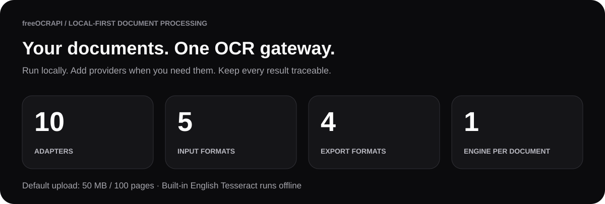
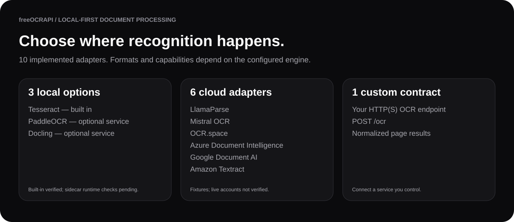
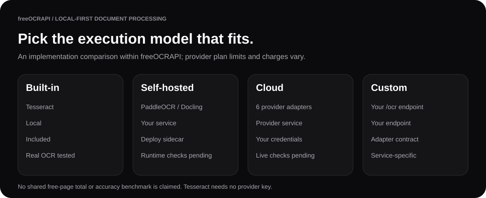
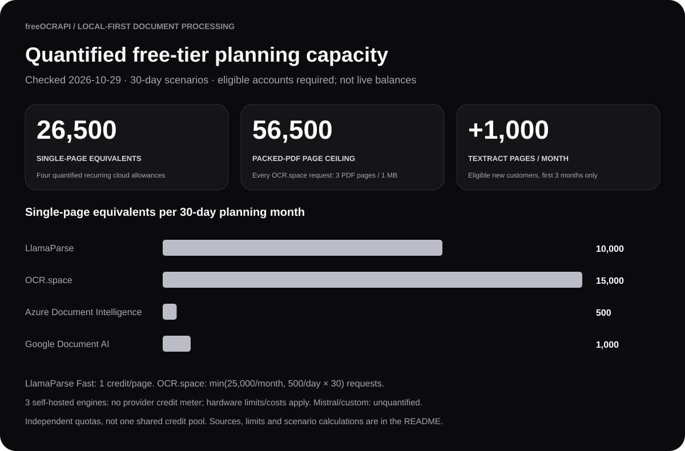
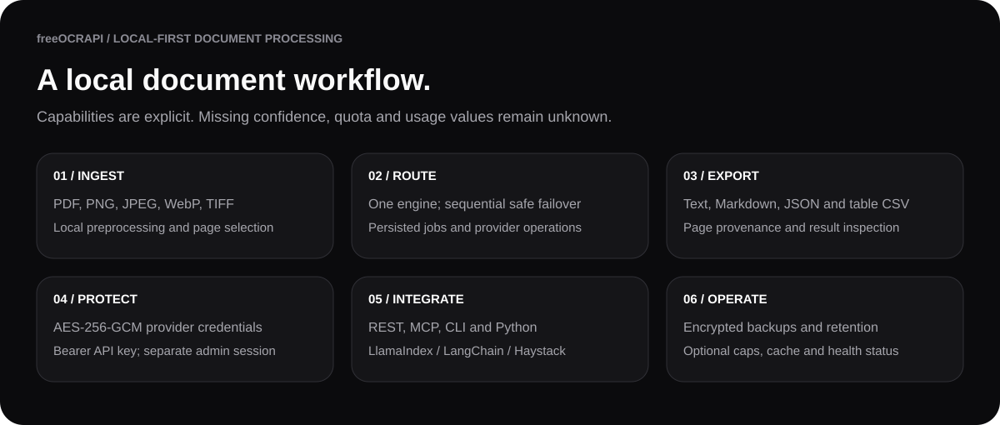
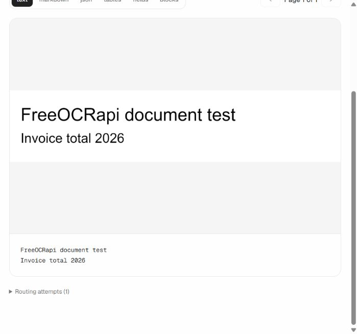
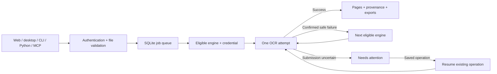
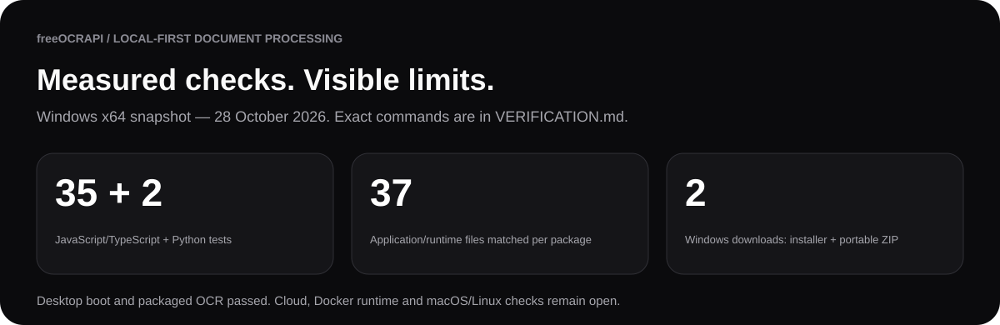

<div align="center">

# freeOCRAPI

**10 OCR adapters. 5 input formats. 4 export formats. One local gateway.**

**Quantified free tiers: up to 26,500 single-page OCR equivalents per 30 days** across four documented cloud allowances. A packed-PDF scenario reaches 56,500 pages; eligible Textract trial users can add 1,000 pages/month for three months. [Calculation, all 10 adapters and conditions below](#free-allowances-and-total).

Turn images and PDFs into text, Markdown and structured page results through a dashboard, Windows desktop app, CLI or API. Built-in Tesseract runs offline. Add cloud providers or self-hosted services when a document needs them.

[](https://github.com/dipeshonnet/freeOCRAPI/actions/workflows/ci.yml)
[](https://github.com/dipeshonnet/freeOCRAPI/stargazers)
[](https://github.com/dipeshonnet/freeOCRAPI/forks)
[](https://github.com/dipeshonnet/freeOCRAPI/releases/latest)
[](https://github.com/dipeshonnet/freeOCRAPI/releases)
[](LICENSE)
[](#contributing)

**Inspired by [FreeLLMAPI](https://github.com/tashfeenahmed/freellmapi), created by Tashfeen Ahmed.**

[Download for Windows](https://github.com/dipeshonnet/freeOCRAPI/releases/latest) · [Run from source](#development) · [Docker](#docker-and-packaging) · [API and integrations](#api-and-integrations)



</div>

**A working v0.1 implementation is available. Full reference parity remains in progress.** Read [PROGRESS.md](PROGRESS.md) for completed checkpoints, verification limits and exact continuation instructions. The approved scope is in [IMPLEMENTATION_PLAN.md](IMPLEMENTATION_PLAN.md).

## Contents

[Why this exists](#why-this-exists) · [Providers](#supported-providers) · [Free allowances and total](#free-allowances-and-total) · [Features](#features) · [Windows desktop](#windows-desktop) · [Development](#development) · [API](#api-and-integrations) · [Screenshot](#screenshot) · [Architecture](#how-it-works) · [Operations](#operations) · [Verification](#verification-and-continuation) · [FAQ](#faq) · [Contributing](#contributing) · [Attribution](#attribution)

## Why this exists

OCR tools differ in their setup, output structure, formats and quotas. Switching between a local engine and several provider SDKs makes even a small document workflow harder to maintain.

freeOCRAPI puts those choices behind one interface. Upload once, choose an engine or routing profile, and receive results with serving-engine and page provenance. Provider keys stay encrypted in your installation. Your applications use a single processing key. One engine processes each document attempt, with safe sequential fallback.

The gateway is MIT-licensed and bundled Tesseract needs no cloud account. Cloud services retain their own prices, accounts and plan limits. The free-tier figures below are conditional planning ceilings across separate providers, not a shared credit balance or an accuracy benchmark.

## Supported providers



| Adapter | Execution | Integration | Verification |
| --- | --- | --- | --- |
| Tesseract | Built in, offline | Text, PDF rasterization, layout blocks | Real image and multipage PDF OCR tested |
| LlamaParse | LlamaIndex cloud | Document parsing, text/Markdown and tables | Implemented; live account checks pending |
| Mistral OCR | Cloud | Layout-aware Markdown, tables and annotations | Normalization/stream-limit fixtures; live checks pending |
| OCR.space | Cloud | Image/PDF text and overlay geometry | Normalization fixtures; live checks pending |
| Azure Document Intelligence | Cloud | Read, layout, forms and invoice analysis | Normalization fixtures; live checks pending |
| Google Document AI | Cloud | OCR, tables and form fields | Normalization fixtures; live checks pending |
| Amazon Textract | AWS cloud | Asynchronous OCR with S3 | Normalization fixtures; live checks pending |
| PaddleOCR | Optional local service | Text and layout | Normalization fixtures; runtime checks pending |
| Docling | Optional local service | Document text, tables and layout | Implemented; runtime checks pending |
| Custom | Your HTTP(S) service | `POST /ocr`, normalized pages | Contract validation; service-specific |

**10 adapters = 1 built-in engine + 2 optional local services + 6 cloud adapters + 1 custom adapter.** These are implemented integrations, not ten bundled models. See the [catalog](server/src/catalog.ts) for exact format and capability declarations.



## Free allowances and total

**Checked 29 October 2026.** Credits, requests, pages and local compute are different units. All ten adapters are covered below; only four publish recurring allowances that can be normalized for this basic-OCR scenario. These are advertised plans, not your remaining balance. Eligibility, account-wide use, reset dates, rate limits and provider changes apply.



| Adapter | Advertised free allowance | Treatment and conditions | Official source |
| --- | --- | --- | --- |
| Tesseract | No provider credit/page meter when run locally | Not a numeric grant. Your hardware, electricity and configured gateway limits apply. | [Project](https://github.com/naptha/tesseract.js) |
| LlamaParse | **10,000 credits/month** on Free | **10,000 basic OCR pages** at Fast's 1 credit/page, with all credits used for parsing and no add-ons. Other tiers consume more. | [Plan](https://developers.llamaindex.ai/llamaparse/general/billing/) · [Rates](https://developers.llamaindex.ai/llamaparse/general/pricing/) · [Fast OCR](https://developers.llamaindex.ai/llamaparse/parse/features/ocr-and-languages/) |
| Mistral OCR | Free-mode usage is account/organization-specific | No universal numeric monthly credit/page grant established from the live public sources. **Excluded as unquantified, not zero.** Check your Limits page. | [Usage/limits](https://docs.mistral.ai/admin/billing-usage/usage-limits) · [Live plans](https://mistral.ai/pricing/) |
| OCR.space | **25,000 requests/month**, also **500 requests/day/IP** | 30-day effective ceiling: **15,000 requests**. Free uploads: 1 MB, up to 3 PDF pages/request. Baseline assumes one page/request; packed-PDF scenario assumes three. | [API plans and limits](https://ocr.space/ocrapi) |
| Azure Document Intelligence | **500 pages/month**, Free F0 resource | Included only for eligible F0 use, not S0 paid usage. F0 processes at most two pages/request; 4 MB file limit. | [Pricing](https://azure.microsoft.com/en-us/pricing/details/document-intelligence/) · [Limits](https://learn.microsoft.com/en-gb/azure/ai-services/document-intelligence/service-limits?view=doc-intel-2.1.0) |
| Google Document AI | **1,000 standard Document OCR pages/month** | Enterprise Document OCR only; other processors/add-ons differ. No separate Cloud Vision allowance is added. | [Detailed OCR pricing](https://cloud.google.com/products/document-ai/pricing) · [Monthly OCR allowance](https://cloud.google.com/use-cases/ocr) |
| Amazon Textract | **1,000 text-OCR pages/month for three months**, eligible new customers | Trial increment only, excluded from recurring total. Forms/Tables/Layout have a separate 100-page allowance that is not stacked into this basic-text calculation. S3/other costs may apply. | [Free tier](https://aws.amazon.com/textract/pricing/) |
| PaddleOCR | No provider credit/page meter when self-hosted | Hardware/hosting and service limits apply. Hosted third-party offerings can charge. | [Project](https://github.com/PaddlePaddle/PaddleOCR) |
| Docling | No provider credit/page meter when self-hosted | Hardware/hosting and service limits apply. Hosted third-party offerings can charge. | [Project](https://github.com/docling-project/docling) |
| Custom OCR endpoint | **Unknown; endpoint-specific** | The adapter supplies no independent credits. Do not assume the configured service is free. | [Local contract](server/src/cloud-providers.ts) |

### Comparable totals

For **one page per OCR.space request** over a **30-day planning month**:

```text
LlamaParse Fast   10,000 credits / 1 credit per page        = 10,000 pages
OCR.space        min(25,000, 500 requests/day × 30) × 1     = 15,000 pages
Azure F0                                                   =    500 pages
Google standard Document OCR                               =  1,000 pages
Recurring single-page planning total                       = 26,500 pages
Eligible Textract text-OCR trial increment                  =  1,000 pages
With the Textract trial, first three eligible months        = 27,500 pages
```

If **every OCR.space request instead holds a three-page PDF within 1 MB**, the OCR.space contribution is `15,000 × 3 = 45,000` pages. That gives a **56,500-page recurring packed-PDF ceiling**, or **57,500** during the eligible Textract trial. File preparation/packing is an assumption, not an automatic gateway feature. Shorter/longer months affect the daily-limited OCR.space contribution.

The three self-hosted engines are outside these finite totals: no provider credit meter does not mean infinite throughput or free hardware. Mistral/custom capacity remains unknown. General cloud signup dollar credits are not added or converted to pages, and retries, add-ons or other account usage reduce available capacity. The gateway does not automatically enforce these advertised provider plans; configure optional caps and verify your account's current allowance.

The Google calculation uses the specific detailed Enterprise Document OCR free band plus the monthly OCR statement; generic product summaries can omit that processor-specific allowance. Cached Mistral search snippets advertising $10/month were rejected because the current live Free plan does not establish that universal grant. [Dated inputs and source notes](docs/free-allowances.json) preserve this distinction.

## Features



- **Ingest:** PDF, PNG, JPEG, WebP and TIFF; default 50 MB / 100-page limits, content validation and guarded public URL downloads.
- **Route:** one active worker, capability-aware profiles/rules, sequential safe failover, persisted jobs/operations, cooldowns and optional per-key caps.
- **Inspect and export:** text, Markdown, blocks, tables and fields where returned; TXT, Markdown, JSON and table CSV downloads. Unknown confidence and usage remain unknown.
- **Protect:** AES-256-GCM provider credentials, one processing key, separate admin sessions, redirect protection, streaming response bounds and CSV formula protection.
- **Integrate:** REST/OpenAPI, five MCP tools, a local CLI, standard-library Python client and three optional framework wrappers.
- **Operate:** cache, retention, encrypted backups/restore, credential health checks, local catalog import/export and language-pack management.

## Windows desktop

Get the **[Windows x64 installer or portable ZIP from Releases](https://github.com/dipeshonnet/freeOCRAPI/releases/latest)**. Build outputs are `FreeOCRapi Setup 0.1.0.exe` and `FreeOCRapi-0.1.0-win.zip`. Extract the entire ZIP before launching `FreeOCRapi.exe`. Builds are unsigned.

Both files were rebuilt with the security fixes recorded in [PROGRESS.md](PROGRESS.md). [Checksums](artifacts/checksums.json) and [package verification](artifacts/package-verification.json) identify this rebuild. The application version remains `0.1.0`; use the hashes to distinguish these downloads from earlier local builds.

GitHub publishes the installer as `FreeOCRapi.Setup.0.1.0.exe` after replacing spaces with periods. Its contents and SHA-256 are identical to the local build named in `checksums.json`.

The desktop includes an embedded Node runtime, English OCR model, local dashboard, server and tray. No separate Node installation or cloud account is required for built-in OCR. Its account signs in automatically, its data lives in the FreeOCRapi application-data folder, and its API uses port 31416 or the next available port. Web installation data stays separate.

## Development

Node.js 24 LTS and pnpm 11.25.0 are required. Run `pnpm install --frozen-lockfile`, then `pnpm dev`. The API uses http://127.0.0.1:3002 and the development dashboard uses http://127.0.0.1:5174. Create your web account on first use. Password recovery prints a code to the server console; it does not send email.

```bash
git clone https://github.com/dipeshonnet/freeOCRAPI.git
cd freeOCRAPI
pnpm install --frozen-lockfile
pnpm dev
```

On this Codex machine, `.\scripts\dev-bootstrap.ps1` discovers the bundled package manager. Add `-Verify` to run checks instead of starting development servers.

`pnpm typecheck`, `pnpm test`, `pnpm build`, and `pnpm start` provide verification and production startup. `pnpm checkpoint` prints the current resume instructions. See `.env.example` for configuration; never copy credentials from another project.

Production requires a persistent 64-character hexadecimal `ENCRYPTION_KEY`; local development saves a generated key beside the database. Back up that key with the data. Hosting defaults to loopback; LAN access additionally requires explicit `HOST` and `ALLOWED_HOSTS` configuration.

## OCR and dashboard

Adapters are implemented for Tesseract, LlamaParse, Mistral OCR, OCR.space, Azure Document Intelligence, Google Document AI, Amazon Textract, PaddleOCR, Docling and a custom OCR service contract. Cloud adapters have not been verified against live accounts. Supply credentials in Keys; they are encrypted with AES-256-GCM.

Input content is validated as PDF, PNG, JPEG, WebP or TIFF. Defaults are 50 MB and 100 pages. English Tesseract runs offline. Settings can install additional official language packs. Rotation, grayscale and thresholding are available locally; cloud adapters explicitly reject options they cannot apply.

Screens cover engine catalog/details and capabilities, routing profiles/rules, credentials, uploads/batches, source/result inspection, job history, document search, analytics/logs, integrations, catalog and operational settings. Downloads include TXT, Markdown, JSON and CSV when tables were returned. Searchable PDF export is not implemented yet.

CSV downloads prefix formula-like cells with an apostrophe to keep OCR text from executing as spreadsheet formulas. This also exports negative numbers as text; JSON preserves the original values.

Jobs and provider operation IDs persist in SQLite. Automatic routing selects enabled, compatible, configured engines and respects optional caps/cooldowns. Explicit engine selections stay pinned. An uncertain submission stops automatic fallback; a saved operation can be resumed from the result screen without submitting twice. Remote cancellation is best-effort. Optional monthly request/page caps use `0` for unlimited and survive history cleanup; they are admission guards rather than guaranteed billing caps.

## API and integrations

Interactive docs: `/v1/docs`. OpenAPI: `/v1/openapi.json`. Processing APIs use the unified bearer key from Keys; administration requires an account session.

```text
POST /v1/files
POST /v1/ocr
GET  /v1/jobs/:id
POST /v1/jobs/:id/cancel
POST /v1/jobs/:id/resume
GET  /v1/jobs/:id/download?format=txt
POST /v1/batches
GET  /v1/models
```

OCR accepts an uploaded `fileId` or a public document `url`, plus engine/profile/options. URL fetching pins validated DNS addresses, rejects private networks, checks redirects and enforces download limits.

Use `node cli/index.mjs --help`. Processing reads `FREEOCRAPI_URL` and `FREEOCRAPI_API_KEY`; administrative commands use `FREEOCRAPI_DASHBOARD_TOKEN`. CLI job IDs are saved in `data/cli/last-jobs.json` without credentials. Resume waiting with `node cli/index.mjs jobs JOB_ID --wait`. The CLI is local and has not been published to npm.

```bash
node cli/index.mjs ocr document.pdf --engine tesseract --out result.txt
node cli/index.mjs jobs JOB_ID --wait
node cli/index.mjs doctor
```

The stateless MCP endpoint is `/mcp`. Python integrations include a standard-library client and LlamaIndex/LangChain/Haystack wrappers. See [integration instructions](integrations/README.md). Indexing and question answering remain in the consuming framework.

```python
from integrations.python.freeocrapi import FreeOCRClient

result = FreeOCRClient().extract("document.pdf")
print(result["text"])
```

| Framework | Wrapper |
| --- | --- |
| LlamaIndex | `FreeOCRReader().load_data("document.pdf")` |
| LangChain | `FreeOCRLoader("document.pdf").load()` |
| Haystack | `FreeOCRConverter().run(sources=["document.pdf"])` |

The five MCP tools are `list_engines`, `extract_document`, `get_job`, `cancel_job` and `get_usage`. Processing endpoints use `Authorization: Bearer <unified-key>`. CLI/Python clients reject gateway redirects; configure the final gateway URL. Optional framework packages require their own installation and live checks.

## Screenshot



Captured from the isolated preview using a synthetic document. The source pixels and extracted text are real; no provider credentials are shown.

## How it works



## Operations

Settings includes cache, retention, HTTP proxy, language packs and password-encrypted full backups. Backups contain the database, document files and encryption key; use a separate password of at least 12 characters. Archive creation currently supports up to 128 MB raw data. Use an offline data-directory backup for larger installations.

Restore validates and stages a backup, rekeys credentials, saves a pre-restore backup and requires a restart. Restored sessions are invalidated. Credential JSON exports require the original installation key; full password-encrypted backups support machine migration.

Credential checks avoid billable OCR and report unknown when no safe probe is supported. Proxy settings currently cover direct REST adapters, not AWS/LlamaCloud SDK transports. Desktop updates require an explicit HTTPS `FREEOCRAPI_UPDATE_URL`; no upstream FreeLLMAPI service is contacted. Live self-updating and automatic pre-update backups remain unverified/unfinished.

## Docker and packaging

Set a persistent `ENCRYPTION_KEY`, then run `docker compose up --build -d freeocrapi`. Optional services use `docker compose --profile docling up -d docling` and `docker compose --profile paddleocr up --build -d paddleocr`. Host endpoints are `http://127.0.0.1:5001` and `http://127.0.0.1:8080`; from the app container use `http://docling:5001` and `http://paddleocr:8080`. Sidecar models may download on first start. Docker configuration validates, but a live image build was not possible while this machine's Docker engine was stopped.

To package desktop: `pnpm build`, `node node_modules/electron/install.js`, then `pnpm desktop:dist:win`. Matching-host scripts `desktop:dist:mac` and `desktop:dist:linux` are also supplied. The preparation script includes Node and its official license notices. A project-local wrapper uses electron-builder's binary reader to generate the NSIS uninstaller without executing the intermediate installer. CI is configured for Windows/macOS/Linux; only Windows packaging was built locally. No prebuilt container registry image is claimed.

## Verification and continuation



The 2026-10-28 Windows x64 snapshot passed **35 JavaScript/TypeScript tests + 2 Python tests**, type checks and production build. **37 application/runtime files and package metadata** match the local build in the unpacked app, installer and portable ZIP. Packaged desktop boot and real offline OCR passed. These measured figures do not imply live cloud, Docker runtime, native spreadsheet or macOS/Linux verification. GitHub badges display this repository's own live activity.

The [initial hosted CI run](https://github.com/dipeshonnet/freeOCRAPI/actions/runs/40660130393) also passed on **Windows, macOS and Ubuntu**: type checks, tests, production build and native unpacked desktop packaging. Native macOS/Linux installer installation and runtime smoke checks remain open. [CI evidence](artifacts/github-ci.json).

Automated tests cover account protection, encryption, actual image/multipage PDF OCR, serialization, safe fallback/resume, quota retention, cache, cancellation/recovery, encrypted backup/restore, URL restrictions and MCP/API access. CLI/Python and packaged-Windows smoke evidence is under `artifacts/`.

Security regression checks cover client redirects, streaming response limits and CSV formula protection. Run `pnpm test` and `python -m unittest integrations.python.test_security -v` (Python 3.12). These tests use synthetic credentials and local/in-memory fixtures.

Verify rebuilt archive contents without installing them: `python scripts/verify-packages.py --sevenzip <path-to-7za.exe>`. Regenerate the source-backed figures after a build with `node scripts/readme-assets.mjs`.

Read `AGENTS.md` and `PROGRESS.md` before continuing. Remaining full-parity work includes localization beyond English, signed remote catalog feeds, richer provider protocol/live tests, searchable PDF export and checks requiring Docker or non-Windows hosts. Quality preference preserves profile order until benchmark ratings exist; no accuracy scores are fabricated.

## FAQ

**Is everything free?** The gateway is MIT-licensed and bundled Tesseract needs no cloud account. Optional providers keep their own prices and quotas.

**Do documents stay local?** Built-in OCR runs locally. Cloud and remote custom adapters send documents to their configured services; choose enabled engines accordingly.

**Do several engines combine a transcript?** Each attempt uses one engine. Routing does not ensemble or merge transcripts.

**Which languages work?** The interface is English. English OCR is bundled; Settings can install additional official Tesseract language packs. Other engines depend on their configuration.

**Is searchable PDF export available?** Not yet. Current exports are TXT, Markdown, JSON and table CSV.

## Contributing

Read [AGENTS.md](AGENTS.md), [PROGRESS.md](PROGRESS.md) and [IMPLEMENTATION_PLAN.md](IMPLEMENTATION_PLAN.md) before changing code. Finish and verify one milestone at a time. Include meaningful regression checks, use synthetic credentials, preserve safe provider-resume behavior, and document exact results and limits. Do not commit `.env` files, local databases, encryption keys, backups or document collections; build downloads belong in release assets.

## Attribution

The screen structure, visual design and routing approach are adapted from [FreeLLMAPI](https://github.com/tashfeenahmed/freellmapi), copyright Tashfeen Ahmed, MIT licensed. The source reference is pinned to commit 2359d30bc2d72347dcea4276ada38ebef204d7ca. The upstream MIT notice is included in LICENSE.

This is an independent OCR adaptation inspired by FreeLLMAPI, not an official FreeLLMAPI release. The README uses OCR-specific figures and measured checks; upstream stars, download totals, token budgets, subscriptions and unsupported capabilities are not carried over.
